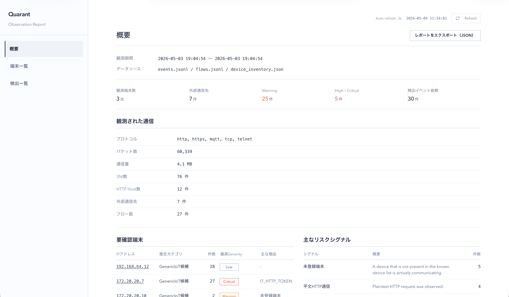

# Quarant

Quarant is a passive network observation tool for IoT devices running on Linux gateways, bridges, or routers.

It analyzes packets from a network interface or pcap file, reconstructs TCP flows, parses protocol metadata, and records network-visible risk signals mapped to the OWASP IoT Top 10.

Quarant does not log in to devices, attack them, brute-force credentials, actively scan networks, or decrypt HTTPS traffic. It focuses only on what can be observed from network traffic — recording each event as an observed fact, possible inference, limitation, and recommended next step.

This is a personal research project, not a production security tool.



## Why Quarant?

IoT devices often behave like black boxes. Users can see the device and the app, but usually cannot see where the device connects, what protocols it uses, or how updates and cloud communication work.

Quarant was built to make that hidden network behavior easier to inspect.

## What Quarant Observes

- Plaintext HTTP requests, headers, cookies, and body fragments
- Authorization headers and token-like values in URLs or bodies
- TLS ClientHello metadata — SNI, TLS version, cipher suites, JA3
- MQTT, Telnet, FTP, RTSP, and CoAP traffic
- Firmware-update-like paths and requests
- Device communication destinations and patterns
- Newly observed or unregistered devices

Each event is recorded with:

| Field | Meaning |
|---|---|
| `observed_fact` | What was actually observed |
| `inference` | What risk it may suggest |
| `limitation` | What cannot be confirmed passively |
| `recommendation` | What to check or do next |

Detected events are risk signals, not confirmed vulnerabilities.

## OWASP IoT Top 10 Mapping

Only network-visible signals are used. Not all categories can be fully diagnosed from traffic alone.

| Category | Network-visible signals |
|---|---|
| I1 Weak, Guessable, or Hardcoded Passwords | Credentials, tokens, and auth-like values in plaintext traffic |
| I2 Insecure Network Services | Telnet, MQTT, FTP, RTSP, CoAP, HTTP admin interfaces |
| I3 Insecure Ecosystem Interfaces | Plaintext API traffic, management endpoints, tokens in URLs |
| I4 Lack of Secure Update Mechanism | Firmware-update-like traffic and weak update visibility signals |
| I5 Use of Insecure or Outdated Components | Lightweight enrichment based on inferred device family and known issue candidates |
| I6 Insufficient Privacy Protection | Stable identifiers, history, backup, sync, and privacy-related endpoints |
| I7 Insecure Data Transfer and Storage | Plaintext HTTP, auth headers, cookies, tokens, MQTT/Telnet plaintext, TLS metadata risks |
| I8 Lack of Device Management | Newly observed devices, unregistered devices, inventory mismatch signals |


## Architecture

```text
packet capture / pcap input
        ↓
TCP flow reconstruction
        ↓
protocol parsers (HTTP / TLS / MQTT / Telnet)
        ↓
risk signal rules
        ↓
events.jsonl / flows.jsonl / device_inventory.json
        ↓
local report viewer
```

## Quick Start

### Requirements

- Linux
- Go 1.24 or later
- libpcap development package
- root or packet capture privileges
- Node.js and npm (for the web report viewer)

Ubuntu / Debian:

```bash
sudo apt update
sudo apt install -y git build-essential libpcap-dev
```

### Build

```bash
git clone https://github.com/SaeYoshizaki/Quarant.git
cd Quarant
go mod download
go build -o quarant ./cmd/quarant
```

### Build the Web Report Viewer

The report viewer is a static Next.js app served by Quarant's built-in server. Build it once before using `--report` or `--open`.

```bash
cd web
NEXT_PUBLIC_API_BASE_URL=http://127.0.0.1:8080 npm run build
cd ..
```

### Analyze a pcap File

```bash
./quarant analyze camera.pcap --out events.jsonl --report --open
```

`--report` starts the built-in report server. `--open` opens the report viewer in your browser automatically.

### Live Observation

```bash
sudo ./quarant live --iface eth0 --out events.jsonl --report --open
```

During live observation, `events.jsonl`, `flows.jsonl`, and `device_inventory.json` are updated in real time and the report viewer refreshes automatically.

Quarant also writes `observations.jsonl` by default. This file is a higher-volume passive observation log for SOC-like review. It records normalized facts before they become risk events, such as flow snapshots, external connections, local connections, TLS SNI, HTTP hosts and requests, DNS/mDNS queries, SSDP discovery, DHCP activity, and NTP sync. Disable it with `--observations-out=-`, or choose a custom path:

```bash
sudo ./quarant live --iface eth0 --out events.jsonl --observations-out logs/observations.jsonl
```

The report viewer reads `observations.jsonl` as a Home SOC summary. It shows total observation volume, external/DNS/HTTP/TLS/noise counts, attack-like activity, hourly timeline buckets, and top destinations, DNS queries, SNI values, HTTP hosts, and source devices.

```bash
./quarant report events.jsonl --observations-in logs/observations.jsonl
```

### Improve Detection Precision

Use the precision engine to turn raw detections and observations into fewer, higher-context incidents. It suppresses DNS-only signals, one-off firewall blocks, and discovery noise, while promoting multi-signal behavior such as plaintext credentials, insecure services, baseline novelty, category deviations, unknown UDP with context, and repeated inbound blocks.

The engine is structured as three layers:

- Observation layer: records raw risk events, flow metadata, DNS, firewall, and protocol observations
- Context layer: compares observations with device baseline and expected category behavior
- Correlation layer: promotes only repeated or mutually reinforcing signals into SOC incidents

```bash
./quarant precision \
  --events events.jsonl \
  --flows flows.jsonl \
  --observations observations.jsonl \
  --inventory device_inventory.json \
  --out precision_report.json \
  --incidents-out incidents.jsonl
```

Generate a human-review label template:

```bash
./quarant eval \
  --incidents incidents.jsonl \
  --labels incident_labels.jsonl \
  --init-labels
```

Edit `incident_labels.jsonl` and mark each incident as `true_positive`, `false_positive`, or `benign`. Add `false_negative` rows for important behavior that Quarant missed. Then compute evaluation metrics:

```bash
./quarant eval \
  --incidents incidents.jsonl \
  --labels incident_labels.jsonl \
  --out precision_eval_report.json
```

### Generate Rule-Based Mitigation Plans

Quarant can turn correlated incidents into a rule-based mitigation plan. This is an early virtual-patching layer: it does not log in to IoT devices or patch firmware. Instead, it proposes gateway-side controls with rationale, estimated side effects, validation metrics, and rollback requirements.

The first implementation is intentionally dry-run oriented. It writes a structured plan and an OpenWrt UCI command preview that prints rules instead of applying them.

```bash
./quarant mitigate \
  --events events.jsonl \
  --flows flows.jsonl \
  --observations observations.jsonl \
  --inventory device_inventory.json \
  --out mitigation_plan.json \
  --rules-out openwrt_mitigation_dryrun.sh \
  --gateway-out gateway_backend_plan.json \
  --rollback-out openwrt_mitigation_rollback.sh
```

`gateway_backend_plan.json` is a backend-neutral gateway rule plan for the generated mitigation actions. The current backend target is OpenWrt UCI in dry-run mode. Each generated rule includes a Quarant managed tag, policy family, device identity assumptions, UCI preview commands, rollback preview commands, and warnings such as IP-only device targeting without a confirmed DHCP static lease.

When the device inventory includes OpenWrt DHCP lease metadata, Quarant carries `mac_address`, `hostname`, `dhcp_lease_expires_at`, and `dhcp_lease_state` into the mitigation action and gateway rule plan. OpenWrt dry-run rules then include `src_mac` in addition to `src_ip`, making per-device targeting less dependent on a changing IP address.

The gateway backend also classifies generated controls as `denylist`, `allowlist`, or `zone_policy` rules. Duplicate backend targets are suppressed, zone policies supersede narrower per-service rules for the same device, and allowlist/denylist collisions for the same target are reported as blocking conflicts for human review.

The mitigation pipeline is:

```text
passive observation
  ↓
precision incidents
  ↓
rule-based mitigation planning
  ↓
impact estimate and rollback requirement
  ↓
gateway rule dry-run
  ↓
post-mitigation re-observation and comparison
```

Current rule-based mitigations include narrow service blocks for plaintext HTTP credential exposure, Telnet, FTP, and plaintext MQTT, plus review-only fallback isolation for high-risk incidents without a safe narrow rule.

After applying or simulating mitigations in a controlled experiment, run a second passive observation window and evaluate the before/after effect:

```bash
./quarant mitigation-eval \
  --plan mitigation_plan.json \
  --before-events before/events.jsonl \
  --before-flows before/flows.jsonl \
  --before-observations before/observations.jsonl \
  --before-inventory before/device_inventory.json \
  --after-events after/events.jsonl \
  --after-flows after/flows.jsonl \
  --after-observations after/observations.jsonl \
  --after-inventory after/device_inventory.json \
  --out mitigation_eval_report.json
```

This report evaluates each mitigation action against its target signals, device risk score delta, and DNS/DHCP/NTP/discovery continuity. It separates `resolved`, `improved`, `residual`, `regressed`, and `resolved_with_continuity_risk` outcomes so risk reduction is not confused with normal-traffic breakage.

For paper-oriented experiments, combine precision, mitigation, and before/after evaluation outputs into a single research report:

```bash
./quarant research-report \
  --precision precision_report.json \
  --precision-eval precision_eval_report.json \
  --mitigation mitigation_plan.json \
  --mitigation-eval mitigation_eval_report.json \
  --out research_report.json \
  --markdown-out research_report.md \
  --csv-dir paper_tables
```

The generated research report summarizes the research question, key metrics, experiment stages, mitigation tables, before/after outcomes, supported claims, missing evidence, and threats to validity. The optional CSV directory writes paper-ready tables such as `metrics.csv`, `incident_summary.csv`, `mitigation_summary.csv`, `mitigation_outcomes.csv`, and `normal_traffic_continuity.csv`.

### Import OpenWrt Router Logs

Quarant can also normalize OpenWrt logs into the same JSON outputs used by the report viewer. This is useful when the router is the IoT gateway and packet capture on a laptop would miss traffic between IoT devices and the internet.

Generate a reviewable OpenWrt setup script for an isolated IoT network:

```bash
./quarant openwrt setup-plan \
  --iot-port lan4 \
  --iot-ip 192.168.50.1 \
  --out openwrt-quarant-setup.sh
```

Review the generated script before running it on OpenWrt. The plan creates an IoT network/zone, enables DHCP and DNS query logging, allows IoT devices to reach DNS/DHCP and WAN, blocks IoT-to-LAN forwarding by default, and enables firewall logging for denied traffic.

```bash
./quarant openwrt import \
  --dhcp-leases /tmp/dhcp.leases \
  --dns-log dnsmasq.log \
  --firewall-log firewall.log \
  --conntrack conntrack.txt \
  --out-dir runs/openwrt-001
```

The importer writes:

- `events.jsonl`
- `flows.jsonl`
- `observations.jsonl`
- `device_inventory.json`

Then open the generated run with:

```bash
./quarant report runs/openwrt-001/events.jsonl
```

If SSH access to OpenWrt is available, Quarant can collect the raw router logs and immediately import them:

```bash
./quarant openwrt collect \
  --host root@192.168.1.1 \
  --ssh-option -o \
  --ssh-option StrictHostKeyChecking=accept-new \
  --out-dir runs/openwrt-001
```

This creates `runs/openwrt-001/raw/` with the collected OpenWrt sources, imports them into Quarant JSON files, and writes `openwrt_collect_status.json` with collection metadata and warnings.

## Example Findings

| Finding | Rule |
|---|---|
| Plaintext HTTP traffic | `I7_HTTP_PLAINTEXT` |
| Token in URL | `I3_AUTH_TOKEN_IN_URL`, `I7_HTTP_TOKEN` |
| Authorization header over HTTP | `I7_HTTP_AUTH` |
| Secret-like value in HTTP body | `I7_HTTP_BODY_SECRET` |
| Suspected HTTP admin interface | `I2_HTTP_ADMIN_INTERFACE_SUSPECTED` |
| Firmware-update-like request | `I4_FIRMWARE_UPDATE_OBSERVED` |
| Telnet traffic | `I2_TELNET_SERVICE_OBSERVED`, `I7_TELNET_PLAINTEXT` |
| Plaintext MQTT traffic | `I2_MQTT_SERVICE_OBSERVED`, `I7_MQTT_PLAINTEXT` |
| Weak TLS cipher offered | `I7_TLS_WEAK_CIPHER_OFFERED` |
| Newly observed device | `I8_NEW_DEVICE_OBSERVED` |

Example event:

```json
{
  "type": "INSECURE_HTTP_TOKEN",
  "severity": "CRITICAL",
  "rule_id": "I7_HTTP_TOKEN",
  "category": "I7",
  "owasp_tags": ["I1", "I3", "I7"],
  "confidence": "high",
  "observed_fact": "Sensitive token or identifier-like query parameter was observed over plaintext HTTP.",
  "inference": "Credentials, session tokens, or stable identifiers may be exposed in transit and in URL logs.",
  "limitation": "Passive monitoring cannot determine whether the value is still valid, whether it is hardcoded, or whether the API has additional protections.",
  "recommendation": "Avoid putting tokens in URLs, use HTTPS, and rotate exposed credentials or tokens if necessary."
}
```
